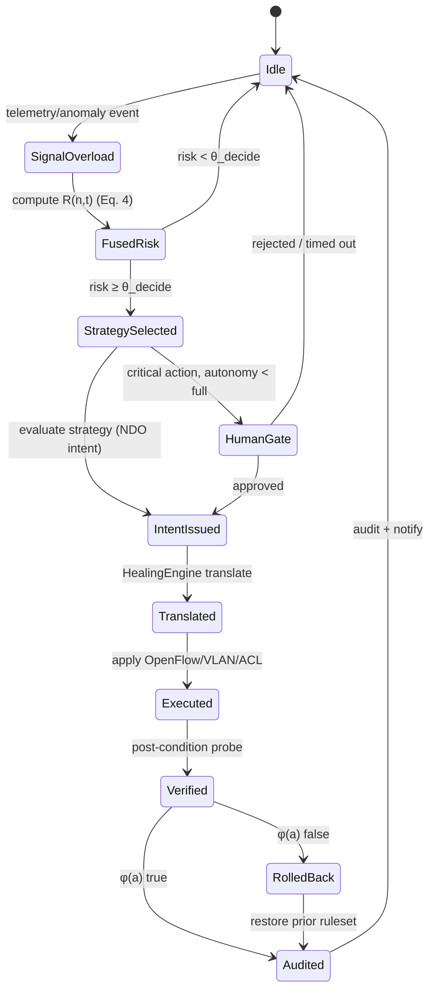

# Research Contribution — AI-Powered Autonomous Zero Trust Self-Healing Network

> Basis document for the IEEE paper and final report. Targeted at a **systems/network venue** (IEEE TNSM / IFIP Networking style).
>
> Status: blueprint v1.0 written before implementation. Modules 1–9 are now implemented and evaluated **in
> simulation**; measured results (simulated network, synthetic failures and attacks) are in
> [`results.md`](results.md). Statements below are design intent unless results.md supports them.

---

## 1. Novelty of the Project

This project contributes five concrete advances over the current state of the art in network operations, AI-driven failure prediction, and zero-trust security:

### 1.1 Closed-Loop Autonomous Cycle
A single feedback control loop

```
predict → trust → decide → heal → verify
```

couples failure prediction, zero-trust scoring, decision making, and intent-based healing. Existing research and products address these concerns in isolation. To the best of our knowledge, no system couples all four into one verified, auditable control loop operating on a programmable data plane.

### 1.2 Heterogeneous Signal Fusion
The Decision Engine is a function of four heterogeneous signal classes fused into a single decision context:

1. Telemetry time-series (latency, loss, bandwidth, CPU, memory, interface/flow statistics)
2. Trust scores (user, device, service)
3. Threat score (DDoS / behavioural anomaly)
4. Topology state (graph, active faults, path availability)

Most existing systems fuse one or two of these. Our fusion model (Section 5) treats them as weighted, policy-tunable evidence rather than separate alarm silos.

### 1.3 Intent-Based Decision / Healing Decoupling (NDO)
The Decision Engine emits vendor-neutral decision intents (`REROUTE`, `ISOLATE`, `QUARANTINE`, `BLOCK`, `RESTORE`, `LOAD_BALANCE`) via a **Network Decision Ontology (NDO)**. A separate Healing Engine translates intents into data-plane actions (OpenFlow rules, VLAN isolation, ACL updates, route changes). This makes the decision core independent of the SDN controller implementation — unlike vendor IBN solutions (Cisco ACI/DNA) that are controller-locked.

### 1.4 Model Hot-Swap Registry (Champion/Challenger)
The Failure Prediction Engine consumes models only through the `IPredictionModel` interface and a model registry. New models are trained offline, validated, and deployed as challengers without code changes; the champion can be rolled back. No prediction logic is hardcoded to a single algorithm.

### 1.5 Verify-or-Rollback Healing
Every healing action carries explicit post-conditions and a verification probe. If verification fails, the action is automatically rolled back to the previous ruleset. This yields quantified healing success, MTTR, and rollback rates rather than fire-and-forget rule injection, and prevents cascading misconfiguration.

---

## 2. Existing Approaches

### 2.1 Reactive Network Management
SNMP polling, ICMP/UDP probes, and static threshold alarms (Nagios, Zabbix, legacy NMS). Detection happens *after* failure. No prediction, no autonomous actuation, no security signal.

### 2.2 Intent-Based Networking (IBN)
Cisco ACI/DNA, Apstra, forward-thinking intent declarations with closed-loop intent verification. Strengths: declarative policy, some automation. Weaknesses: proprietary controller coupling, no AI failure prediction, no zero-trust fusion, healing limited to vendor primitives.

### 2.3 ML-Based Failure Prediction
- Datacenter hardware/network failure prediction using logs, counters, and ML (LSTM/RF/GBM) — e.g., Google and Microsoft datacenter predictive maintenance, NTT latency-prediction systems.
- Strengths: predictive lead time, high AUC on labeled incidents.
- Weaknesses: prediction only; no actuation path; no trust/security signal; models fixed in pipeline.

### 2.4 Self-Healing / Autonomic Computing
IBM MAPE-K loop (Monitor → Analyse → Plan → Execute → Knowledge). The conceptual ancestor of our work. Typically applied to single domains (server/VM health) rather than network path reconfiguration with security policy enforcement.

### 2.5 Zero Trust Architecture
NIST SP 800-207: never trust, always verify; continuous authentication and authorization of every request. Production deployments (ZTNA) enforce access policy but use largely static risk scoring — they do not recompute trust from live behavioural anomalies nor feed trust into routing decisions.

### 2.6 SDN Controllers
Ryu, ONOS, OpenDaylight provide programmable control planes and topology awareness but ship no autonomous decision layer; healing logic must be hand-built on top.

---

## 3. Limitations of Existing Systems

| Limitation | Consequence |
|---|---|
| Reactive-only monitoring | No predictive lead time; outage has already occurred at detection |
| Prediction-only ML | Predictions unused operationally; no actuation or security context |
| Healing-only automation | No prediction, no verification; risk of cascading misconfiguration |
| Controller-locked IBN | Vendor lock-in; intent not portable across SDN stacks |
| Static Zero Trust | Risk policies not updated from live behaviour; trust not fused into paths |
| No unified benchmark | No shared metric for comparing autonomous self-healing networks |

This project proposes both an architecture and an evaluation protocol (Section 9) to address the final limitation.

---

## 4. Proposed Algorithm

The system is event-driven and runs the following closed loop asynchronously per control interval:

```
Algorithm 1: Autonomous Self-Healing Control Loop
--------------------------------------------------------------------------
Require: active SDN data plane, telemetry pipeline, model registry
repeat every control interval t:
  1. F  ← TelemetryService.latest()                 # feature matrix
  2. P  ← PredictionEngine.predict(F)               # p(failure) per node
  3. T  ← TrustEngine.scores()                      # trust per subject
  4. G  ← TopologyService.graph()                   # graph + fault state

  5. for each node n with signal overloaded:
       risk(n) ← R(P(n), T(n), Thr(n))              # fused risk (Eq. 4)
       if risk(n) ≥ θ_decide:
           ctx ← buildDecisionContext(n, P, T, Thr, G)
           D  ← DecisionEngine.strategy[type].evaluate(ctx)   # intent
           plan ← HealingEngine.translate(D)        # OpenFlow/VLAN/ACL
           execute(plan)
           if verify(plan.post_conditions):
               commit(plan); audit(plan, verified=True)
           else:
               rollback(plan); audit(plan, verified=False)
               raise recovery.failed event
--------------------------------------------------------------------------
```

### 4.1 Per-Strategy Sub-Algorithms
- **Reroute/Restore**: constrained shortest-path over the weighted graph (Section 5.5).
- **Load Balancing**: assign flows to least-utilized admissible paths (`min-max` utilization).
- **Isolate/Quarantine/Block**: port-level isolation, VLAN reassignment, ACL rule insertion — emitted as NDO intents, executed by the Healing Engine.

---

## 5. Mathematical Model

### 5.1 Notation
- `n ∈ N` nodes (routers, switches, hosts); `l ∈ L` links
- `s` subjects (user, device, service); `t` time
- `x(n,t)` feature window for node `n` at time `t`

### 5.2 Failure Prediction (Calibrated Probability)
The active model `f_θ` maps a feature window to a failure probability:

```
p̂(n,t) = σ( f_θ( x(n,t) ) )                        (1)
```

with `x` = {latency, packet loss, bandwidth utilization, CPU, memory, flow entropy}, `σ` the sigmoid, and `f_θ` selected from the model registry (baseline: logistic regression; target: LSTM sequence model). Platt scaling calibrates the output; a regression head produces time-to-failure `TTF(n,t)`.

### 5.3 Trust Score
Dynamic trust with exponential decay of anomalies (recent anomalies weigh more):

```
T(s,t) = T_base(s) − Σ_j w_j · a_j(s,t) · κ^(t−t_j)      (2)
```

- `T_base(s)` baseline trust of subject `s`
- `a_j(s,t)` anomaly flag of type `j` (behavioural, environmental, fingerprint mismatch)
- `w_j` severity weight, `κ ∈ (0,1)` decay factor

### 5.4 Threat and Composite Risk
Threat index (normalized to [0,1]):

```
Thr(s,n,t) = H_flow(n,t) + R_auth(s,t) + F_anom(s,n,t)   (3)
```

- `H_flow` entropy-based DDoS index (flow-entropy drop signals flooding)
- `R_auth` failed-authentication rate, `F_anom` anomalous-flow count (anomaly detector output)

Fused composite risk:

```
R(n,t) = α·p̂(n,t) + β·(1 − T(s,n,t)) + γ·Thr(s,n,t) + δ·I_fault(n,t)   (4)
```

with `α + β + γ + δ = 1`, policy-tunable weights, `I_fault` the known fault-state indicator.

### 5.5 Decision Objective (Reroute / Restore / Load Balance)
Choose a path to minimize cumulative cost subject to connectivity and capacity:

```
minimize   Σ_l∈path c(l)          subject to  y_l binary path vars,
connectivity(path), cap(path) ≥ demand                    (5)
```

Edge cost:

```
c(l) = w_loss·loss(l) + w_lat·latency(l) + w_rel·(1 − rel(l))   (6)
rel(l) = 1 − p̂(l,t)
```

Solved with constrained shortest path (NetworkX) at demonstration scale; Dijkstra-with-penalty for large graphs. Load balancing minimizes the maximum link utilization over the flow set.

### 5.6 Healing Verification
Action `a` succeeds iff its post-conditions `φ(a)` hold (e.g., connectivity probe, flow-table diff, ACL reachability check). Empirical success probability:

```
Pr[φ(a)] ≈ #verified(a) / #executed(a)                      (7)
```

Rollback triggers when `¬φ(a)`.

---

## 6. Decision Flow



Autonomy levels (policy-configurable): L1 human-in-the-loop for all healing; L2 auto-heal reversible actions only; L3 full autonomy with audit.

---

## 7. Comparison with Existing Systems

| System | Predict | Zero Trust | Autonomous | Verify/Rollback | Controller-Agnostic |
|---|---|---|---|---|---|
| SNMP / threshold ops (Nagios, Zabbix) | No | No | No | No | No |
| Cisco IBN (ACI/DNA) | No | Partial | Partial | No | No |
| ML failure prediction (Google/Microsoft/NTT) | Yes | No | No | No | No |
| Pure SDN controllers (Ryu/ONOS) | No | No | No | No | N/A |
| Static Zero Trust (ZTNA) | No | Yes | No | No | Yes |
| **Proposed system** | **Yes (calibrated)** | **Yes (dynamic)** | **Yes (HITL)** | **Yes (verify-or-rollback)** | **Yes (NDO)** |

---

## 8. Performance Metrics

### 8.1 Failure Prediction
- AUC (area under ROC), precision@k, recall, F1
- Brier score (probability calibration)
- RMSE on time-to-failure (TTF)
- Mean lead time between first high-confidence prediction and actual failure

### 8.2 Healing
- MTTR (time from detection to verified healing)
- Time-to-detect, time-to-heal
- Healing success rate (`#verified/#executed`)
- Rollback rate
- User-visible packet loss during recovery (%)

### 8.3 Zero Trust
- AUROC on anomalous-access detection
- False-accept rate, false-reject rate
- Trust-score stability (variance across benign windows)

### 8.4 Decision
- Decision latency (p95)
- Correct-action rate against labeled ground truth
- False-positive healing (healing when not needed) / false-negative healing (missed healing)
- Reroute convergence time

### 8.5 System-Level
- End-to-end autonomy (actions completed without human intervention)
- Availability gain vs. baseline under injected fault load
- Audit completeness (every action mapped to a decision + evidence)

---

## 9. Evaluation Methodology

### 9.1 Dataset & Scenario Library
Telemetry is generated from the Mininet enterprise topology. A labeled scenario library covers all seven fault classes: router failure, switch failure, cable cut, congestion, packet loss, DDoS, interface shutdown — each with ground-truth failure times.

### 9.2 Baselines
- (a) Threshold-alarm reactive monitoring (detect-and-alert only)
- (b) Prediction-only (no actuation)
- (c) Static routing + manual recovery
- (d) Random / round-robin reroute

### 9.3 Protocol
- N ≥ 10 seeded runs per scenario × condition
- Paired Wilcoxon signed-rank test (or paired t-test) at α = 0.05
- Report mean ± 95% confidence interval

### 9.4 Ablation Studies
Remove trust term, prediction term, and verify/rollback individually to quantify each component's marginal contribution to MTTR, success rate, and correctness.

### 9.5 Reproducibility
- Pinned Docker images and dependency versions
- Fixed random seeds across ML and simulation
- CI-executed end-to-end drill suite
- Results auditable via `predictions`, `decisions`, `recovery_actions` tables

### 9.6 Threats to Validity
- Synthetic-traffic realism: mitigated with realistic traffic profiles and multi-seed runs
- Mininet CPU limits: controlled resource quotas per container
- Model drift: offline retrain pipeline and champion/challenger registry

---

## 10. Paper Mapping (Draft Outline)

| IEEE Paper Section | Source |
|---|---|
| Introduction | §1 (novelty), §3 (gap) |
| Related Work | §2 |
| Architecture | docs/architecture.md, docs/modules.md |
| Fusion & Decision Model | §5, docs/class-diagrams.md |
| Implementation | docs/docker-deployment.md |
| Evaluation | §8, §9 |
| Conclusion | §1.5, roadmap exit criteria |
