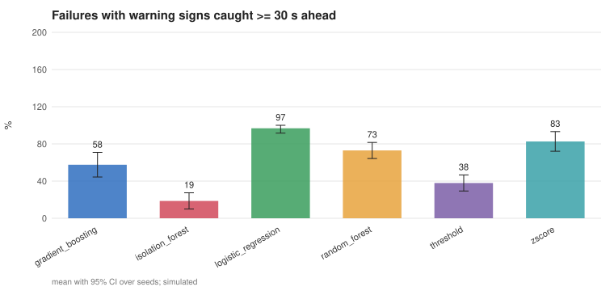
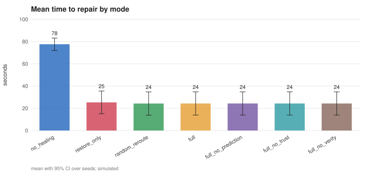
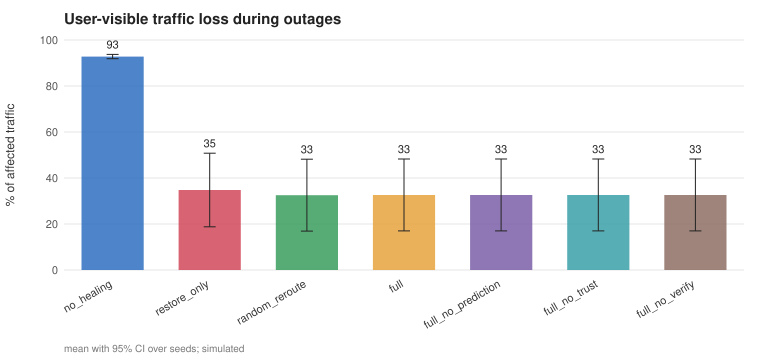
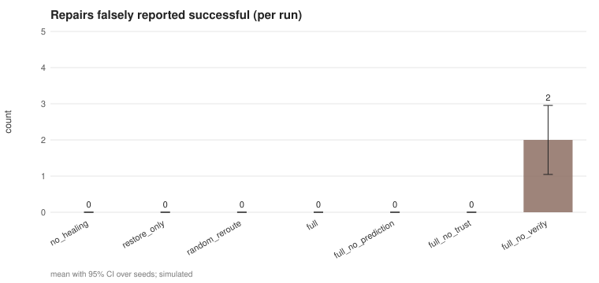
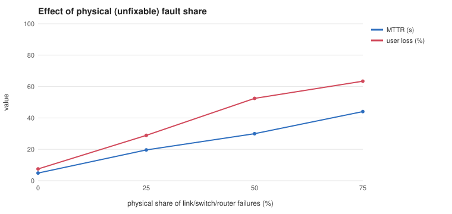
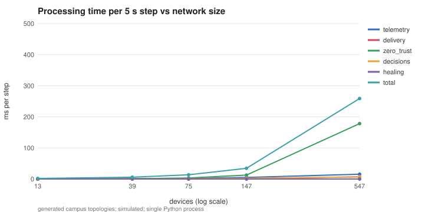

# Results (draft chapter)

> **Scope of every result in this chapter.** All experiments ran on the
> project's **simulated** network: an in-memory data plane whose state is
> read by simulated telemetry. Failures, the warning patterns that precede
> some of them ("precursors"), and attacks are **synthetic** — designed by
> us. "Correct" decisions mean agreement with ground-truth rules we wrote.
> Nothing here has been measured on Mininet, Open vSwitch or real hardware.
> The results show that the system's components work as designed and how
> they interact; they do not show performance on a real enterprise network.

Raw data, the auto-generated report and all figures:
[`docs/results/full-run/`](results/full-run/report.md). Reproduce with

```bash
PYTHONPATH=network/src python3 -m network.experiments.runner --profile full --out results/full
```

(commit `86bead5`, Python 3.9.6, numpy 2.0.2, scikit-learn 1.6.1, scipy
1.13.1, macOS arm64; ~55 minutes of compute). Configuration-file hashes are
recorded in `results.json`.

## 1. Protocol

Following research doc §9.3: **10 independent seeded runs per condition**
(3 simulated hours each, 12 network failures and 6 attacks per run, unless
stated); metrics reported as **mean [95 % confidence interval]** (Student t,
clipped to each metric's valid range); comparisons by the **paired
Wilcoxon signed-rank test** with **Holm correction**, α = 0.05, effect size
as the matched-pairs rank-biserial correlation *r*. For prediction, each of
the 10 repetitions uses its own independent train / validation / test runs
(9 runs × 2 simulated hours).

Physical faults (software cannot fix them): link 50 %, switch 20 %,
router 20 % of failures. Topology for Modules 6–7: the redundant
simulation topology (10 devices, 10 links); scalability and baseline (d)
use generated campus topologies.

## 2. Failure prediction (Module 4)

Objective O1 (fixed before modelling): ≥ 80 % of failures that have
warning signs caught ≥ 30 s ahead, with ≤ 1 false alarm per hour.

| Model | Caught ≥30 s (with signs) | Caught (no signs) | False alarms/h | Median lead | Avg precision | Reps meeting O1 |
|---|---|---|---|---|---|---|
| Health thresholds | 38 [29, 47] % | 0 % | 0.00 | 48 s | 0.09 | 0 % |
| **Z-score baseline** | 83 [72, 93] % | 0 % | 0.00 | 72 s | 0.28 | 60 % |
| Isolation Forest | 19 [10, 27] % | 0 % | 0.07 | 82 s | 0.13 | 0 % |
| **Logistic regression** | **97 [92, 100] %** | 0 % | 0.00 | 72 s | 0.29 | **90 %** |
| Random forest | 73 [64, 82] % | 0 % | 0.35 | 58 s | 0.27 | 30 % |
| Gradient boosting | 58 [44, 71] % | 1 [0, 3] % | 0.33 | 52 s | 0.24 | 10 % |



Against the z-score baseline (paired, Holm): thresholds, Isolation Forest
and gradient boosting are **significantly worse** (recall and average
precision, p ≤ 0.023, |r| ≥ 0.96). Logistic regression is higher on
average (+15 points recall, r = +0.73) but **not significantly** after
correction (p = 0.10); random forest is not significantly different.

Interpretation:

- Failures **without** warning signs are not predicted by any model
  (0–1 %), as designed — and confirming the earlier schedule-leak fix.
- The simple, interpretable models (z-score, logistic regression) are the
  strongest on these clean synthetic ramps; tree ensembles overfit and
  raise more false alarms. The single-suite comparison in Module 4 had
  picked random forest as champion; with 10 repetitions that choice does
  not hold up, which is itself a finding about selection on one split.
- The value of ML over the statistical baseline is **not established**
  on this data (O1 met in 90 % vs 60 % of repetitions, difference not
  significant).

## 3. Zero Trust (Module 5)

| Metric (§8.3) | Value |
|---|---|
| Detection AUROC (trust drop vs. attacking) | 0.946 [0.940, 0.951] |
| False-accept rate (attack flows allowed) | 1.03 [0.36, 1.69] % |
| False-reject rate (legitimate flows of non-attacking devices) | 0.00 % |
| Containment cost (attackers' own normal traffic blocked) | 30.6 [25.6, 35.7] % |
| Attacks detected / attackers quarantined | 100 % / 60 [54, 66] % |
| Policy-vs-enforcement disagreements | 0 |

Every synthetic attack was detected in its first step; no innocent device
was ever denied legitimate access. The false accepts are the first flood
packets, which the policy permits until the flood is detected. 40 % of
attackers are not quarantined because high base trust absorbs one anomaly
type — their forbidden requests are still denied per request.

## 4. Decision engine (Module 6)

| Metric (§8.4) | Value |
|---|---|
| Correct-action rate | 100.0 [100.0, 100.0] % |
| Missed incidents (false-negative healing) | 0.0 % |
| Unneeded actions per hour (false-positive healing) | 0.03 [0.00, 0.11] |
| Proactive actions per run | 3.0 [1.8, 4.2] |
| Decision latency p95 | 0.18 [0.16, 0.19] ms |

The correct-action rate measures agreement with rules written alongside
the strategies (a negative-control test shows it does drop for a worse
policy), so it mainly shows robust behaviour on noisy end-to-end signals.

## 5. Self-healing (Module 7): baselines and ablations

Baselines (§9.2): **(a)** threshold alarms only and **(c)** static
routing + manual recovery = `no_healing`; **(b)** prediction without
actuation = `no_healing` (the predictor runs but nothing acts);
**(d)** random reroute. Ablations (§9.4): no prediction, no trust term,
no verification.

| Mode | MTTR | Healed before manual repair | User-visible loss | Success rate | Escalated / run | False success claims / run |
|---|---|---|---|---|---|---|
| no_healing (a, b, c) | 78 [72, 83] s | 0 % | 92.8 [91.9, 93.7] % | — | 0 | 0 |
| restore_only | 25 [15, 36] s | 69 [56, 82] % | 34.8 [18.8, 50.8] % | 57 [41, 72] % | 1.9 | 0 |
| **full** | **24 [14, 35] s** | **71 [58, 84] %** | **32.6 [17.0, 48.2] %** | **78 [68, 88] %** | 1.9 | **0** |
| random_reroute (d) | 24 [14, 35] s | 71 [58, 84] % | 32.5 [16.9, 48.2] % | 78 [68, 88] % | 1.9 | 0 |
| full_no_prediction | 24 [14, 35] s | 71 [58, 84] % | 32.6 [17.0, 48.2] % | 72 [61, 84] % | 1.9 | 0 |
| full_no_trust | 24 [14, 35] s | 71 [58, 84] % | 32.6 [17.0, 48.2] % | 78 [68, 88] % | 1.9 | 0 |
| full_no_verify | 24 [14, 35] s | 71 [58, 84] % | 32.6 [17.0, 48.2] % | **100 %** | **0** | **2.0 [1.0, 3.0]** |





Statistical tests:

- **Healing vs no healing**: MTTR −58 s and user-visible loss −61 points
  (median paired differences), p = 0.006, r = −1.00 for every healing mode
  — every one of the 10 runs improved.
- **Verification (ablation)**: removing it raises the *reported* success
  rate from 78 % to 100 % (p = 0.023) while producing 2 false success
  claims per run (p = 0.022) and hiding every escalation: repairs of
  physical faults are reported as done although the network shows them
  still down. This is the strongest single result: verify-or-rollback is
  what makes the reported numbers trustworthy.
- **Prediction (ablation)**: no effect on MTTR or loss (p = 1); success
  rate drops slightly without it (78 % → 72 %, p = 0.023) because fewer
  proactive reroutes are verified. Simulated detection is already within
  one 5 s collection, so predicting cannot beat reacting here; it can
  only help where real detection is slower.
- **Trust term (ablation)**: no effect on any healing metric — the
  failures are network faults, and security actions are driven by trust
  levels directly, not by the Eq. 4 trust term.
- **Restore-only vs full**: rerouting adds a little (loss 34.8 → 32.6 %)
  because only the core link has an alternative path in this topology.

All unhealed outages are physical switch/router failures, which software
cannot fix and single-homed devices cannot route around.

### Baseline (d) on a larger topology (campus 8 × 4, 43 devices)

| Mode | MTTR | User-visible loss | Path stretch |
|---|---|---|---|
| no_healing | 75 [68, 82] s | 92.9 % | — |
| full (Eq. 6 cheapest path) | 18 [10, 26] s | 22.5 [14.3, 30.6] % | 1.17 [1.15, 1.20] |
| random_reroute | 18 [10, 26] s | 22.5 [14.3, 30.6] % | 1.20 [1.16, 1.25] |

Random path choice restores service just as fast (MTTR and loss: p ≥ 0.66)
but uses longer paths (stretch +0.016, p = 0.004, r = +1.00). The delivery
model does not price path length or congestion, so the benefit of
cost-based routing appears only as stretch here; with load-aware traffic
or latency-sensitive services it would matter more.

## 6. Sensitivity



| Physical (unfixable) share | MTTR | Healed before repair | User loss | Success |
|---|---|---|---|---|
| 0 % | 5 s | 100 % | 7.5 % | 100 % |
| 25 % | 20 s | 74 % | 28.9 % | 79 % |
| 50 % | 30 s | 60 % | 52.4 % | 70 % |
| 75 % | 44 s | 37 % | 63.4 % | 56 % |

The headline healing numbers depend strongly on how many failures are
physical: with none, every outage heals within one collection; at 75 %,
most cannot be healed by software. Any claim about MTTR must state this
assumption. (5 seeds per point.)

| Collection interval | MTTR | User loss |
|---|---|---|
| 2 s | 19 s | 29.9 % |
| 5 s | 21 s | 31.3 % |
| 10 s | 24 s | 33.8 % |

Detection and repair scale with the collection interval, as expected.

| Share of failures with warning signs | Z-score caught | Logistic caught | Avg precision (z / logistic) |
|---|---|---|---|
| 0 % | — | — | 0.02 / 0.02 (chance level) |
| 50 % | 80 % | 100 % | 0.26 / 0.28 |
| 100 % | 83 % | 98 % | 0.43 / 0.47 |

With no warning signs, prediction collapses to chance — prediction is only
as good as the precursors present in the data.

## 7. Scalability



| Devices | Links | Demands | Total per step | Telemetry | Delivery | Zero Trust | Decisions |
|---|---|---|---|---|---|---|---|
| 13 | 13 | 17 | 1.9 ms | 0.3 | 0.1 | 0.2 | 0.4 |
| 39 | 42 | 65 | 5.9 ms | 1.1 | 0.3 | 1.1 | 0.4 |
| 75 | 82 | 129 | 13.6 ms | 2.1 | 0.8 | 3.4 | 0.6 |
| 147 | 162 | 257 | 34.5 ms | 5.2 | 1.6 | 12.6 | 2.2 |
| 547 | 578 | 1025 | 258.9 ms | 15.4 | 6.8 | 178.2 | 7.0 |

At 547 devices one 5 s step takes 0.26 s in a single Python process —
comfortably real-time. The **Zero Trust engine dominates and grows
super-linearly** (switch rules are recompiled for every device every step);
incremental rule compilation is the obvious optimisation before larger
deployments. Decision latency stays in milliseconds.

## 8. Threats to validity

- **Synthetic data**: traffic, failures, warning patterns and attacks are
  designed. Prediction and detection results show that designed patterns
  are learnable/detectable, not that real networks exhibit them.
- **Simulation fidelity**: detection delay is effectively one collection;
  link-load telemetry is not route-aware; the delivery model ignores
  latency and congestion along new paths; failures never overlap.
- **Circular ground truth**: decision correctness is judged against rules
  written with the same design as the strategies.
- **Small topology**: only one core link has an alternative path in the
  main topology, limiting what rerouting can show; the campus topologies
  are generated and simulation-only.
- **Researcher-chosen parameters**: thresholds, weights (Eq. 4), physical
  fault shares and attack mixes were set by us; sensitivity analysis
  covers some but not all of them.
- **No live validation**: Mininet/Ryu execution, live telemetry and
  real switch rule installation are untested (docs/deployment.md lists the
  required work).

## 9. Summary of contributions supported by evidence

1. A complete closed loop — telemetry → prediction → Zero Trust →
   decisions → verified self-healing — runs end to end and is
   demonstrable live (dashboard simulation mode).
2. **Verify-or-rollback is essential**: without verification the system
   reports 100 % success while 2 repairs per run did nothing.
3. Automated healing cuts mean time to repair from 78 s to 24 s and
   user-visible loss from 93 % to 33 % on the simulated network, with the
   size of the gain governed by the share of software-fixable faults.
4. Zero Trust with continuous trust scoring detects every synthetic
   attack with 0 % false rejects for legitimate devices.
5. On these data, simple predictors match or beat complex ML; prediction
   adds little to healing when detection is already fast.
