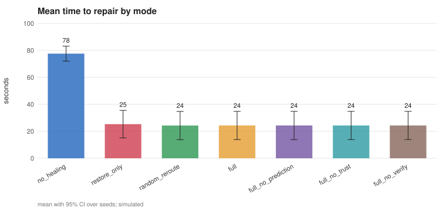
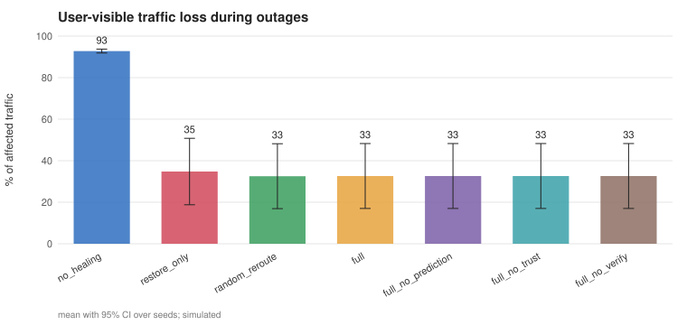
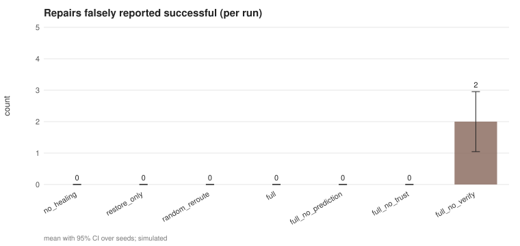
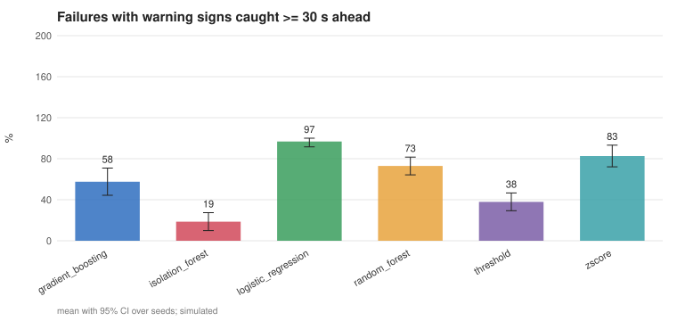
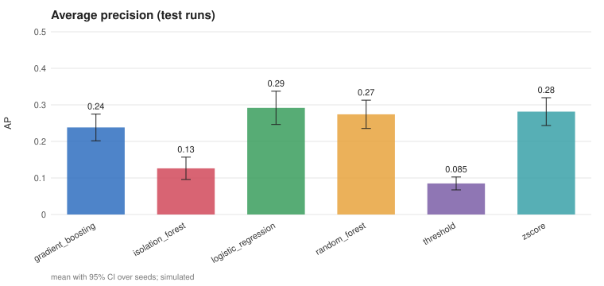
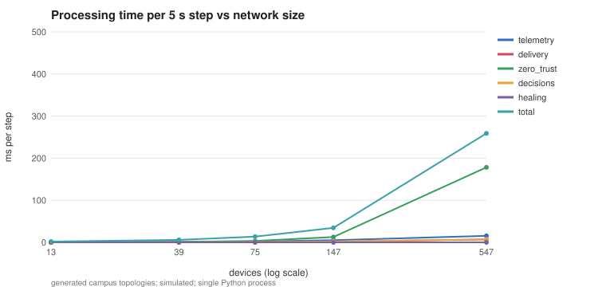
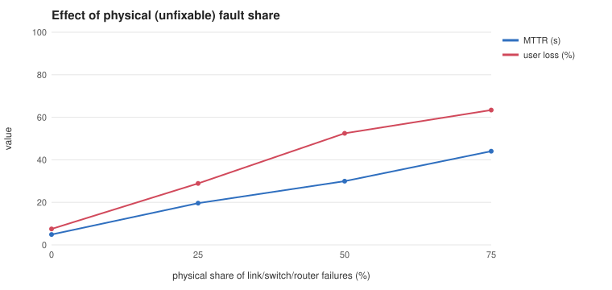
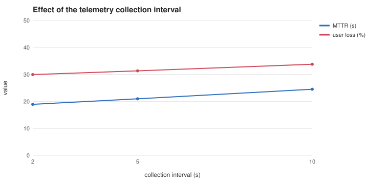

# Experiment report (Module 9)

> All results come from the SIMULATED network. Failures, warning patterns (precursors) and attacks are SYNTHETIC; "correct" decisions mean agreement with written rules. See docs/results.md for interpretation.

- Profile: **full**, seeds [1, 2, 3, 4, 5, 6, 7, 8, 9, 10]
- Commit: `86bead57ae0c5606d3cf9b02b8cb07c9df421321` (uncommitted changes: False)
- Python 3.9.6 · macOS-15.6.1-arm64-arm-64bit
- Libraries: numpy 2.0.2, sklearn 1.6.1, scipy 1.13.1, yaml 6.0.3, fastapi 0.128.8
- Runtime: 3317 s

Cells: mean [95 % CI] over seeds. Tests: paired Wilcoxon signed-rank, Holm-corrected, α = 0.05.

## Failure prediction (Module 4)

| Model | Caught ≥30 s, with signs | Caught, no signs | False alarms/h | Median lead | Avg precision | O1 met (share of reps) |
|---|---|---|---|---|---|---|
| threshold | 38 [29, 47]% | 0 [0, 0]% | 0.00 [0.00, 0.00] | 48 [35, 60] s | 0.09 [0.07, 0.10] | 0 [0, 0]% |
| zscore | 83 [72, 93]% | 0 [0, 0]% | 0.00 [0.00, 0.00] | 72 [64, 80] s | 0.28 [0.24, 0.32] | 60 [23, 97]% |
| isolation_forest | 19 [10, 27]% | 0 [0, 0]% | 0.07 [0.01, 0.13] | 82 [46, 118] s | 0.13 [0.10, 0.16] | 0 [0, 0]% |
| logistic_regression | 97 [92, 100]% | 0 [0, 0]% | 0.00 [0.00, 0.00] | 72 [61, 82] s | 0.29 [0.25, 0.34] | 90 [67, 100]% |
| random_forest | 73 [64, 82]% | 0 [0, 0]% | 0.35 [0.00, 0.81] | 58 [50, 65] s | 0.27 [0.24, 0.31] | 30 [0, 65]% |
| gradient_boosting | 58 [44, 71]% | 1 [0, 3]% | 0.33 [0.00, 0.75] | 52 [40, 65] s | 0.24 [0.20, 0.27] | 10 [0, 33]% |

| Metric | Comparison | n | Median difference | Effect r | p (Holm) | Significant |
|---|---|---|---|---|---|---|
| recall_with_precursor | threshold vs zscore | 10 | -0.418 | -1.00 | 0.00977 | yes |
| recall_with_precursor | isolation_forest vs zscore | 10 | -0.688 | -1.00 | 0.00977 | yes |
| recall_with_precursor | logistic_regression vs zscore | 10 | 0.15 | +0.73 | 0.101 | no |
| recall_with_precursor | random_forest vs zscore | 10 | -0.0667 | -0.81 | 0.101 | no |
| recall_with_precursor | gradient_boosting vs zscore | 10 | -0.261 | -1.00 | 0.0231 | yes |
| average_precision | threshold vs zscore | 10 | -0.185 | -1.00 | 0.00977 | yes |
| average_precision | isolation_forest vs zscore | 10 | -0.164 | -1.00 | 0.00977 | yes |
| average_precision | logistic_regression vs zscore | 10 | 0.014 | +0.45 | 0.465 | no |
| average_precision | random_forest vs zscore | 10 | -0.00272 | -0.27 | 0.492 | no |
| average_precision | gradient_boosting vs zscore | 10 | -0.0437 | -0.96 | 0.0117 | yes |
| false_alarms_per_hour | threshold vs zscore | 10 | 0 | +0.00 | 1 | no |
| false_alarms_per_hour | isolation_forest vs zscore | 10 | 0 | +1.00 | 0.211 | no |
| false_alarms_per_hour | logistic_regression vs zscore | 10 | 0 | +0.00 | 1 | no |
| false_alarms_per_hour | random_forest vs zscore | 10 | 0 | +1.00 | 0.211 | no |
| false_alarms_per_hour | gradient_boosting vs zscore | 10 | 0.0833 | +1.00 | 0.211 | no |

## Zero Trust (Module 5)

| Condition | AUROC | FAR | FRR | Containment cost | Attacks detected | Attackers quarantined | Time to detect | PDP/PEP mismatches |
|---|---|---|---|---|---|---|---|---|
| zero_trust | 0.946 [0.940, 0.951] | 1.03 [0.36, 1.69]% | 0.00 [0.00, 0.00]% | 30.6 [25.6, 35.7]% | 100 [100, 100]% | 60 [54, 66]% | 0.0 [0.0, 0.0] s | 0 [0, 0] |

## Decision engine (Module 6)

| Condition | Correct actions | Missed | Unneeded actions/h | Proactive actions/run | Latency p95 |
|---|---|---|---|---|---|
| decision_engine | 100.0 [100.0, 100.0]% | 0.0 [0.0, 0.0]% | 0.03 [0.00, 0.11] | 3.0 [1.8, 4.2] | 0.18 [0.16, 0.19] ms |

## Self-healing (Module 7): baselines and ablations

Baselines (§9.2): (a) threshold alarms only and (c) static routing + manual recovery = `no_healing`; (b) prediction without actuation = `no_healing` with the predictor running (it does not act); (d) = `random_reroute`. Ablations (§9.4): `full_no_prediction`, `full_no_trust`, `full_no_verify`.

| Mode | MTTR | Healed before repair | User loss | Success | Escalated/run | False claims/run | Path stretch |
|---|---|---|---|---|---|---|---|
| no_healing | 78 [72, 83] s | 0 [0, 0]% | 92.8 [91.9, 93.7]% | — | 0.0 [0.0, 0.0] | 0.0 [0.0, 0.0] | — |
| restore_only | 25 [15, 36] s | 69 [56, 82]% | 34.8 [18.8, 50.8]% | 57 [41, 72]% | 1.9 [1.0, 2.8] | 0.0 [0.0, 0.0] | — |
| full | 24 [14, 35] s | 71 [58, 84]% | 32.6 [17.0, 48.2]% | 78 [68, 88]% | 1.9 [1.0, 2.8] | 0.0 [0.0, 0.0] | 1.25 [1.25, 1.25] |
| full_no_prediction | 24 [14, 35] s | 71 [58, 84]% | 32.6 [17.0, 48.2]% | 72 [61, 84]% | 1.9 [1.0, 2.8] | 0.0 [0.0, 0.0] | 1.25 [1.25, 1.25] |
| full_no_verify | 24 [14, 35] s | 71 [58, 84]% | 32.6 [17.0, 48.2]% | 100 [100, 100]% | 0.0 [0.0, 0.0] | 2.0 [1.0, 3.0] | 1.25 [1.25, 1.25] |
| random_reroute | 24 [14, 35] s | 71 [58, 84]% | 32.5 [16.9, 48.2]% | 78 [68, 88]% | 1.9 [1.0, 2.8] | 0.0 [0.0, 0.0] | 1.25 [1.25, 1.25] |
| full_no_trust | 24 [14, 35] s | 71 [58, 84]% | 32.6 [17.0, 48.2]% | 78 [68, 88]% | 1.9 [1.0, 2.8] | 0.0 [0.0, 0.0] | 1.25 [1.25, 1.25] |

### Against no healing

| Metric | Comparison | n | Median difference | Effect r | p (Holm) | Significant |
|---|---|---|---|---|---|---|
| mttr_s | restore_only vs no_healing | 10 | -57.8 | -1.00 | 0.00586 | yes |
| mttr_s | full vs no_healing | 10 | -57.8 | -1.00 | 0.00586 | yes |
| mttr_s | random_reroute vs no_healing | 10 | -58.1 | -1.00 | 0.00586 | yes |
| user_loss_pct | restore_only vs no_healing | 10 | -56.4 | -1.00 | 0.00586 | yes |
| user_loss_pct | full vs no_healing | 10 | -61 | -1.00 | 0.00586 | yes |
| user_loss_pct | random_reroute vs no_healing | 10 | -61.4 | -1.00 | 0.00586 | yes |

### Ablations against full

| Metric | Comparison | n | Median difference | Effect r | p (Holm) | Significant |
|---|---|---|---|---|---|---|
| mttr_s | full_no_prediction vs full | 10 | 0 | +0.00 | 1 | no |
| mttr_s | full_no_verify vs full | 10 | 0 | +0.00 | 1 | no |
| mttr_s | full_no_trust vs full | 10 | 0 | +0.00 | 1 | no |
| user_loss_pct | full_no_prediction vs full | 10 | 0 | +1.00 | 0.952 | no |
| user_loss_pct | full_no_verify vs full | 10 | 0 | +0.00 | 1 | no |
| user_loss_pct | full_no_trust vs full | 10 | 0 | +0.00 | 1 | no |
| success_rate | full_no_prediction vs full | 10 | -0.0595 | -1.00 | 0.0234 | yes |
| success_rate | full_no_verify vs full | 10 | 0.183 | +1.00 | 0.0229 | yes |
| success_rate | full_no_trust vs full | 10 | 0 | +0.00 | 1 | no |
| false_success_claims | full_no_prediction vs full | 10 | 0 | +0.00 | 1 | no |
| false_success_claims | full_no_verify vs full | 10 | 2 | +1.00 | 0.0216 | yes |
| false_success_claims | full_no_trust vs full | 10 | 0 | +0.00 | 1 | no |

## Baseline (d): random vs cost-based rerouting on campus-8x4

| Mode | MTTR | Healed before repair | User loss | Success | Escalated/run | False claims/run | Path stretch |
|---|---|---|---|---|---|---|---|
| no_healing | 75 [68, 82] s | 0 [0, 0]% | 92.9 [92.3, 93.5]% | — | 0.0 [0.0, 0.0] | 0.0 [0.0, 0.0] | — |
| full | 18 [10, 26] s | 80 [71, 90]% | 22.5 [14.3, 30.6]% | 77 [69, 84]% | 1.8 [1.1, 2.5] | 0.0 [0.0, 0.0] | 1.17 [1.15, 1.20] |
| random_reroute | 18 [10, 26] s | 80 [71, 90]% | 22.5 [14.3, 30.6]% | 77 [70, 84]% | 1.8 [1.1, 2.5] | 0.0 [0.0, 0.0] | 1.20 [1.16, 1.25] |

| Metric | Comparison | n | Median difference | Effect r | p (Holm) | Significant |
|---|---|---|---|---|---|---|
| mttr_s | random_reroute vs full | 10 | 0 | +0.00 | 1 | no |
| mttr_s | full vs no_healing | 10 | -55.6 | -1.00 | 0.00391 | yes |
| user_loss_pct | random_reroute vs full | 10 | 0 | +0.33 | 0.655 | no |
| user_loss_pct | full vs no_healing | 10 | -72.7 | -1.00 | 0.00391 | yes |
| path_stretch | random_reroute vs full | 10 | 0.0158 | +1.00 | 0.00391 | yes |
| path_stretch | full vs no_healing | 0 | — | +0.00 | 1 | no |

## Sensitivity

### Physical (software-unfixable) fault share

| Physical share | MTTR | Healed before repair | User loss | Success |
|---|---|---|---|---|
| 0.0 | 5 [5, 5] s | 100 [100, 100]% | 7.5 [5.6, 9.4]% | 100 [100, 100]% |
| 0.25 | 20 [3, 37] s | 74 [46, 100]% | 28.9 [8.4, 49.3]% | 79 [59, 100]% |
| 0.5 | 30 [17, 43] s | 60 [40, 79]% | 52.4 [17.6, 87.2]% | 70 [53, 87]% |
| 0.75 | 44 [30, 58] s | 37 [6, 67]% | 63.4 [27.4, 99.4]% | 56 [37, 75]% |

### Telemetry collection interval

| Interval (s) | MTTR | Healed before repair | User loss | Success |
|---|---|---|---|---|
| 2.0 | 19 [2, 36] s | 72 [45, 99]% | 29.9 [8.3, 51.6]% | 76 [55, 97]% |
| 5.0 | 21 [5, 37] s | 72 [45, 99]% | 31.3 [12.2, 50.5]% | 78 [59, 97]% |
| 10.0 | 24 [10, 39] s | 72 [45, 99]% | 33.8 [18.3, 49.2]% | 81 [67, 96]% |

### Share of failures with warning signs (prediction)

| Warning-sign share | Model | Caught ≥30 s (with signs) | Caught (all) proxy: AP | False alarms/h |
|---|---|---|---|---|
| 0.0 | zscore | — | 0.02 [0.02, 0.03] | 0.37 [0.00, 1.04] |
| 0.0 | logistic_regression | — | 0.02 [0.02, 0.02] | 0.27 [0.08, 0.45] |
| 0.5 | zscore | 80 [60, 100]% | 0.26 [0.19, 0.33] | 0.00 [0.00, 0.00] |
| 0.5 | logistic_regression | 100 [100, 100]% | 0.28 [0.20, 0.35] | 0.00 [0.00, 0.00] |
| 1.0 | zscore | 83 [71, 96]% | 0.43 [0.35, 0.52] | 0.00 [0.00, 0.00] |
| 1.0 | logistic_regression | 98 [95, 100]% | 0.47 [0.39, 0.55] | 0.17 [0.00, 0.53] |

## Scalability (generated campus topologies, one Python process)

| Size | Devices | Links | Demands | Total ms/step | Telemetry | Delivery | Zero Trust | Decisions | Healing |
|---|---|---|---|---|---|---|---|---|---|
| 2x4 | 13 | 13 | 17 | 1.9 | 0.3 | 0.1 | 0.2 | 0.4 | 0.0 |
| 4x8 | 39 | 42 | 65 | 5.9 | 1.1 | 0.3 | 1.1 | 0.4 | 0.0 |
| 8x8 | 75 | 82 | 129 | 13.6 | 2.1 | 0.8 | 3.4 | 0.6 | 0.0 |
| 16x8 | 147 | 162 | 257 | 34.5 | 5.2 | 1.6 | 12.6 | 2.2 | 0.0 |
| 32x16 | 547 | 578 | 1025 | 258.9 | 15.4 | 6.8 | 178.2 | 7.0 | 0.0 |

## Figures

